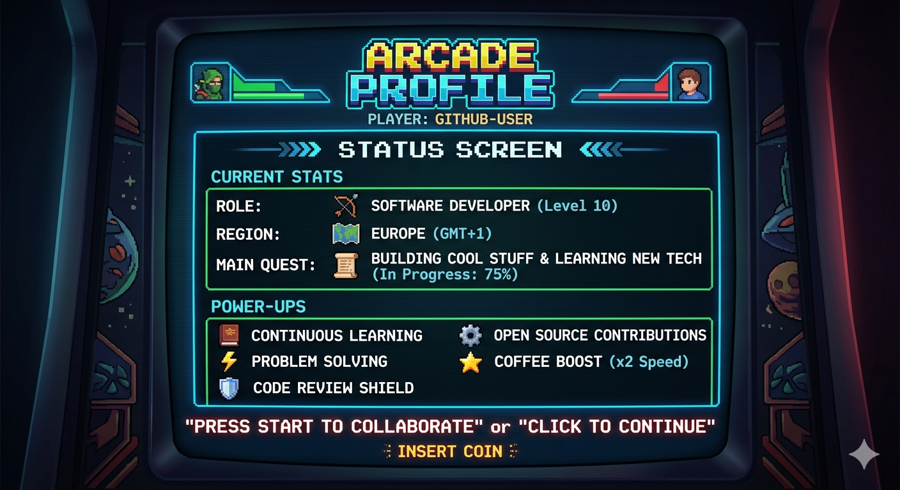

  

## Hey, I'm Eladio 👋

Full-stack software engineer from Spain. I spend most of my days on the frontend with Angular, React and TypeScript, but I'm just as comfortable going down the stack to design APIs, model data and wire everything together. I especially enjoy the part of the job that comes after _"it works"_: making code readable, easy to review and easy for the next person to pick up.

Before all this I started a Law degree. Turns out I liked building things more than arguing about them — though I still read the fine print.

### 🎯 What I'm up to

- 🏗️ Building full-stack web applications that stay maintainable as they grow.
- ☁️ Levelling up on cloud architecture and how frontend and backend fit into it.
- ⚛️ Exploring Next.js and the newer React patterns.
- 💬 Happy to chat about frontend architecture, API design, TypeScript or tooling.

### 🧰 Toolbox

**Frontend**

  

**Backend & tooling**

  

 

  
If you want to talk shop, team up on something or just say hi:

  

    &nbsp;
    
  

